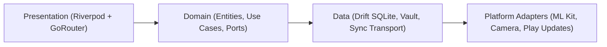

# Architecture & Security

**My Sweet Home** follows **Clean Architecture** with **Ports & Adapters** so domain rules remain independent from Flutter, SQLite, and platform SDKs.

## Layered Architecture



- **Presentation**: Riverpod state providers/controllers and `GoRouter` declarative navigation (`lib/features/*/presentation`, `lib/app/`).
- **Domain**: Pure Dart entities (`freezed`), `Result<T, Failure>` error handling, and abstract **Ports** (`lib/core/`, `lib/features/*/domain`).
- **Data**: **Drift** (reactive SQLite) repositories, local encrypted **Vault**, and **Sync Transport** (`CompositeSyncTransport` for LAN P2P and optional user-owned cloud storage).

## Security & Privacy Controls

| Control | Implementation |
|---|---|
| **Encrypted Local Database** | SQLite persistence protected by encryption keys managed via the `Vault` layer |
| **Deterministic Money & Time** | Money stored as integer cents (`int`); all timestamps persisted in **UTC** |
| **Offline-First Network Policy** | Zero unconsented network calls; external integrations sit behind testable ports |
| **Play Store Install Isolation** | Auto-update checks run only when installed from Google Play (`com.android.vending`) |

## Column-based CRDT Sync

When devices in a **Household** sync over LAN:

- Every shared table row tracks a stable row identity and per-column UTC timestamps.
- Concurrent offline edits on separate columns merge without conflict; edits to the same column resolve deterministically by timestamp and peer tie-breaker.

## Regionalization Extensibility

To keep domain boundaries clean (`test/architecture/dependency_rule_test.dart`), regionalization descriptors live in `lib/core/regionalization/regionalization_models.dart` while OCR parser implementations stay inside `lib/features/ocr/domain/`:

- **App Locales (`AppLocaleRegistry`)**: Persists `app_locale` (`system` or an `AppLocaleDescriptor.id`) in SQLite via `SettingsRepository` and binds it to `MaterialApp.router`. Adding a new `app_<lang>.arb` bundle and 1 descriptor entry exposes it in Settings automatically.
- **Receipt Formats (`ReceiptFormatRegistry`)**: Persists `receipt_format` (`auto` or a `ReceiptFormatDescriptor.id`). In `auto` mode, `CompositeReceiptParser` uses a zero-overhead fast path for a single parser and scores multiple registered parsers via `scoreReceiptDraft` when additional regional formats are contributed.

## Quality Gate (`make check`)

Every pull request and release runs the automated verification pipeline:

```bash
make check
```

`make check` enforces formatting (`make format`), up-to-date `build_runner` code generation, static analysis (`make analyze`), unit/widget/architecture tests (`make test`), and coverage thresholds (`make coverage`). See [CI/CD & Fastlane](infra/fastlane-deploy.md) for release automation details.
