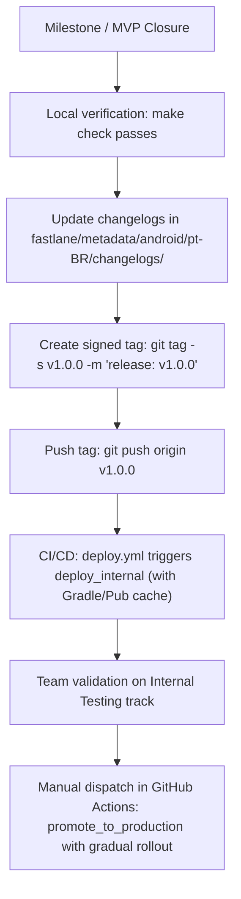

# Operational Guide: Fastlane & CI/CD Automation

> Infrastructure reference for building, signing, publishing, and continuous deployment of the Android application.
> Ref: `RNF-004`, `RNF-012`.

---

## 1. Overview

Build and release automation for **My Sweet Home** on Android is orchestrated via **Fastlane**
integrated with **GitHub Actions**. The pipeline ensures:
- The quality gate (`make check`: static analysis, unit/widget tests, architecture tests, and coverage) runs and passes before any release build.
- The release keystore signs the artifact securely without leaking credentials into source control.
- Split APKs satisfy the 60 MB size limit (`RNF-004`).
- Google Play Console publication follows distribution tracks:
  - **Internal Testing (`internal`)**: Closed testing track for team verification.
  - **Production (`production`)**: Public track with phased rollout support (e.g., 10% to 100%).

---

## 2. File Structure

```text
├── Gemfile                            # Fastlane gem dependency
├── Gemfile.lock                       # Frozen gem dependencies
├── .github/
│   └── workflows/
│       ├── flutter.yml                # CI: analyze, check, test, and PR builds
│       └── deploy.yml                 # CD: release automation on v* tags and dispatch
├── android/
│   ├── key.properties                 # Local release keystore config (git-ignored)
│   └── fastlane/
│       ├── Appfile                    # package_name (br.com.innominata.mysweethome)
│       └── Fastfile                   # Android automation lanes
└── fastlane/
    └── metadata/android/              # Play Store metadata and changelogs
        └── pt-BR/
            └── changelogs/
                └── default.txt        # Default release notes
```

---

## 3. Prerequisites & Local Setup

### Requirements
- **Ruby** (version 3.2+ or 4.0+)
- **Bundler** (`gem install bundler`)
- **Java 17 JDK** (compatible with Flutter's Gradle build)
- **Flutter** (version pinned in `.fvmrc`)

### Installing Fastlane Dependencies
From the repository root:

```bash
bundle install
```

To validate environment integrity and installed tooling:

```bash
cd android
bundle exec fastlane doctor
```

---

## 4. Credentials & Secrets Configuration

### 4.1 Release Keystore (Android)
Release compilation requires an RSA signing key (`upload-keystore.jks`).

#### Local Execution:
Create `android/key.properties` (never committed to git):

```properties
storePassword=<KEYSTORE_PASSWORD>
keyPassword=<KEY_PASSWORD>
keyAlias=<KEY_ALIAS>
storeFile=upload-keystore.jks
```

Place `upload-keystore.jks` inside `android/app/` or specify an absolute path in `storeFile`.

#### CI Execution (GitHub Actions):
Fastlane generates `android/key.properties` automatically and decodes the keystore from the following GitHub Secrets:
- `ANDROID_KEYSTORE_BASE64`: Base64-encoded `.jks` file (`base64 -w 0 upload-keystore.jks`).
- `KEYSTORE_PASSWORD`: Password for the keystore.
- `KEY_ALIAS`: Alias of the key inside the keystore.
- `KEY_PASSWORD`: Key password.

### 4.2 Google Play Console (Service Account)
For communicating with Google Play Developer API (Supply):
1. In Google Cloud Console, create a **Service Account** linked to the Google Play Developer account.
2. Grant permissions for release management and testing tracks.
3. Export the private key as JSON.
4. Configure the GitHub Secret:
   - `PLAY_STORE_JSON_KEY`: Raw JSON or base64-encoded string of the Service Account key.

Locally, you can set the environment variable:
```bash
export PLAY_STORE_JSON_KEY_FILE="/path/to/service-account.json"
```
Or place the file at `android/fastlane/play-store-credentials.json` (git-ignored).

---

## 5. Fastlane Lanes (`Fastfile`)

All lanes are executed from the `android/` directory using `bundle exec fastlane <lane>`:

| Lane | Description | Example Usage |
|---|---|---|
| `doctor` | Validates environment (Flutter, Java, Android SDK, package name) | `bundle exec fastlane doctor` |
| `analyze` | Runs static analysis (`dart analyze lib test` and `custom_lint`) | `bundle exec fastlane analyze` |
| `test` | Runs unit/widget tests with coverage | `bundle exec fastlane test` |
| `arch` | Runs architecture rules tests | `bundle exec fastlane arch` |
| `verify` | Runs full pre-build gate (`make check`) | `bundle exec fastlane verify` |
| `build_bundle` | Builds signed Release Android App Bundle (`.aab`) | `bundle exec fastlane build_bundle` |
| `build_apk` | Builds Release split APKs and validates size <= 60 MB (`RNF-004`) | `bundle exec fastlane build_apk` |
| `validate_apk_size` | Validates size of already-compiled APKs | `bundle exec fastlane validate_apk_size` |
| `deploy_internal` | Builds (if needed) and uploads AAB to Internal Testing track | `bundle exec fastlane deploy_internal` |
| `promote_to_production` | Promotes version from internal track to Production with rollout | `bundle exec fastlane promote_to_production rollout:0.2` |

### Useful Parameters:
- `dry_run:true`: Simulates execution without performing actual upload or promotion to Play Store.
- `rollout:0.1`: Sets rollout fraction (e.g., `0.1` = 10%, `1.0` = 100%).
- `version_code:<num>`: Specifies version code when promoting.

---

## 6. CI/CD Pipeline on GitHub Actions

The workflow [`.github/workflows/deploy.yml`](https://github.com/innominata-ltda/my-sweet-home/blob/main/.github/workflows/deploy.yml) automates deployment:

### Trigger 1: Version Tag Push
When pushing a `v*` tag (e.g., `git tag v1.0.0 && git push origin v1.0.0`):
1. Checks out code and configures Ruby 3.3, Java 17 (with Gradle cache), Python 3.12, and Flutter (with SDK and Pub cache).
2. Executes `make check` for rigorous pre-build validation.
3. Builds the optimized, signed release `.aab` (`deploy_internal`).
4. Publishes `.aab` to the **Internal Testing** track on Google Play Store.
5. Saves `.aab` (and `.apk`, if requested) as a GitHub Actions workflow artifact (30-day retention).

### Trigger 2: Manual Dispatch (`workflow_dispatch`)
From GitHub's *Actions* tab:
- **`track`**: `internal` or `production`
- **`action`**: `build_and_deploy` or `promote_to_production` (skips heavy build and check steps, executing only track promotion via Play Store API)
- **`rollout`**: percentage (e.g., `0.1`, `0.5`, `1.0`, or `10%`)
- **`build_apks`**: `true` or `false` (additionally builds split APKs for download as artifacts)
- **`dry_run`**: `true` or `false`

---

## 7. Integrated Release Flow

As defined in the release procedure:



---

## 8. Common Troubleshooting

| Issue | Probable Cause | Resolution |
|---|---|---|
| `Release keystore not configured` | Missing `key.properties` or CI secrets | Create `android/key.properties` locally or set `ANDROID_KEYSTORE_BASE64` and passwords in repository secrets. |
| `Google Play Console credentials not configured` | Missing `PLAY_STORE_JSON_KEY` | Configure Service Account and add JSON key to GitHub secrets or local file. |
| `APKs exceeded 60 MB limit` | Violation of `RNF-004` | Analyze dependencies, ensure split-per-abi build is enabled, and optimize design system assets. |
| `Could not retrieve response as fastlane runs in non-interactive mode` | Fastlane invoked from project root | Run from the `android` directory (`cd android && bundle exec fastlane <lane>`). |
| ADB / Gradle port conflict | Stuck daemon on host | Terminate instances with `adb kill-server` and run `cd android && ./gradlew --stop`. |
| Release crash (R8/ML Kit) | R8 removed `ComponentLoader` | Keep rules in `android/app/proguard-rules.pro`. |
